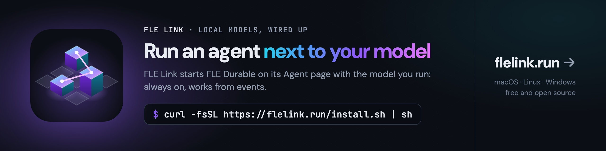

[](https://flelink.run)

<div align="center">

# FLE Durable

**An always-on local agent that works from events.**

Events in, one durable queue, one agent. It survives restarts without losing or repeating anything,
plans its own follow-ups, and asks before anything it cannot undo.

[Quick start](#quick-start) ·
[How it works](#how-it-works) ·
[Events](#where-events-come-from) ·
[API](#api) ·
[FLE Link](https://flelink.run) ·
[FLE engine](https://github.com/sirfyyn/FastLocalExperts) ·
[Rin](https://huggingface.co/sirfyyn/Rin-Deepseek-V4.1-Flash-1017-FLE-GGUF)

[](LICENSE)
[](package.json)

</div>

## What it is

Most local agents wait for you to type. FLE Durable runs all the time next to your local model and acts when
something happens: an item on its agenda is due, a tool sends a webhook, you write to it. Every event lands in a
queue inside one SQLite file before the agent sees it, so a crash or a reboot neither loses an event nor runs one
twice. When a task needs a later look, the agent puts it on its own agenda ("check in 20 minutes whether the
download finished") instead of keeping a turn open.

It is built on [pi-durable](https://github.com/earendil-works/pi) (Earendil Works): durable conversations, tasks
and documents with checkpoints. FLE Durable adds the event side: the queue, the agenda, webhooks, approvals, and
ports for event sources of your own.

```text
 agenda (you + the agent) ─┐
 webhooks from your tools ─┼──► durable queue ──► agent (pi-durable) ──► tools: files, shell, web
 your chat ────────────────┤     (SQLite)          │  local model via /v1
 your own sources ─────────┘                       └─► approvals for destructive steps
```

## Part of FLE

| | |
|---|---|
| [**FLE**](https://github.com/sirfyyn/FastLocalExperts) | the engine: a llama.cpp fork that runs large Mixture-of-Experts models on one GPU |
| [**FLE Link**](https://flelink.run) | the layer above: installs the engine, picks a model that fits, serves `/v1`, Studio and desktop app |
| **FLE Durable** | the agent above that: always on, works from events, uses whatever model FLE Link serves |

The easiest way to run FLE Durable is the **Agent** page in FLE Link: it installs FLE Durable, starts it with the model
of the Engine page, shows the agenda by day, what waits and what asks you, and gives your tools a webhook key.

With FLE Link around it, the agent also has:

- **the chat**: while the agent runs, FLE Link's chat talks to it (a switch goes straight to the model);
- **tickets, a calendar and a list of events** it keeps with you, on the Agent page;
- **your calendars**, read only: FLE Link mirrors Google and iCloud calendars you connect in its Settings;
- **git and gh in your repos**, when you sign in to GitHub in FLE Link;
- **computer use**: the screen, mouse and keyboard of your computer, off until you allow it on the Agent page for
  30 minutes;
- **`flelink code`**: the agent on the project in the current folder, from the terminal.

## Quick start

### With FLE Link

1. Install [FLE Link](https://flelink.run) (`curl -fsSL https://flelink.run/install.sh | sh`) and load a model, for example [Rin - Deepseek V4.1 Flash 1017](https://huggingface.co/sirfyyn/Rin-Deepseek-V4.1-Flash-1017-FLE-GGUF) (`rin-deepseek-v41-dspark`), or any model on the Engine page.
2. In FLE Link: **Agent → Install FLE Durable**. It fetches this repository at the commit that FLE Link version was
   tested with (needs git and Node 22.19 or newer) and starts it. Tick "Start with FLE Link" to keep it on.
3. Write to it in the chat. From a terminal: `flelink code` in a project folder.

To run your own copy instead (a checkout you work on), enter its folder under **Agent → Connection**.

### On its own

Any OpenAI-compatible server works: `llama-server`, FLE, FLE Link, vLLM, Ollama's `/v1`.

```bash
git clone https://github.com/sirfyyn/fle-durable && cd fle-durable && npm ci --ignore-scripts
export FLE_DURABLE_TOKEN=$(openssl rand -hex 32)
export FLE_DURABLE_MODEL_URL=http://127.0.0.1:8080/v1   # your model server
echo '{"model": {"contextWindow": 32768, "maxTokens": 8192}}' > config.json   # its context window
export FLE_DURABLE_CONFIG=$PWD/config.json
node src/main.js
```

It listens on `http://127.0.0.1:8740`. Talk to it over the [API](#api), or open its page with a one-time code:

```bash
curl -s -X POST -H "Authorization: Bearer $FLE_DURABLE_TOKEN" http://127.0.0.1:8740/api/session/code
# then open http://127.0.0.1:8740/?code=<code>
```

## How it works

- **One durable queue.** An event is first stored (one commit), then handed to the agent as a turn with the event's
  id as request id. A crash in between hands the same event over again, and pi-durable makes the second hand-over a
  no-op. The same id sent twice later is recognised too.
- **The owner first.** Your own messages go before every waiting background event. Each event becomes its own turn after
  the running one; **Stop** ends a long turn.
- **Events are data.** Only your messages are instructions. Webhooks, web pages, files and command output reach the
  agent marked as data.
- **Approvals only where it matters.** Deleting your home folder, `git reset --hard`, formatting a disk and the like are
  stopped until you approve exactly that command (`request_approval`). Everything else the agent simply does.
- **Survives restarts.** Conversations, the queue, the agenda and approvals live in one SQLite file. Open turns resume
  from their last checkpoint.

## Where events come from

| Source | What |
|---|---|
| **Chat** | you write to it (`POST /api/message`, its page, FLE Link) |
| **Agenda** | items you plan (once, daily, on certain days, every N minutes) and items the agent plans for itself with `agenda_plan`; it can cancel only its own |
| **Webhook** | `POST /api/events` from any tool: CI, home automation, mail filters, cron |
| **Your own** | a module with `create(ctx)` returning `{ start, stop }`, enabled in the config |

A source of your own, for example every text file dropped into a folder becomes an event
([examples/folder-source.js](examples/folder-source.js)):

```json
{ "ports": { "sources": ["builtin", { "use": "./examples/folder-source.js", "folder": "~/inbox" }] } }
```

```bash
node src/main.js check-source ./examples/folder-source.js   # checks it against the contract
```

Every port is filled by `builtin`, `off`, a registered name or your module; all of them pass the same contract check.

## API

Every call needs `Authorization: Bearer <token>` (or the page's cookie after a one-time code).

| Route | What |
|---|---|
| `GET /api/health` | model, storage, queue, sources |
| `POST /api/message` `{text, id?}` | you write (right of way) |
| `GET /api/conversation` · `GET /api/stream` | the conversation, and its events as server-sent events |
| `POST /api/abort` | stop the running turn |
| `GET` · `POST /api/agenda` · `DELETE /api/agenda/<id>` · `POST /api/agenda/<id>/pause` | the agenda |
| `POST /api/events` `{text, id?, from?, ref?}` | webhook into the queue |
| `GET /api/queue` · `POST /api/queue/pause` | what waits; pause and resume |
| `GET /api/approvals` · `POST /api/approvals/<id>` `{decision: granted\|refused, note?}` | approvals |
| `POST /api/session/code` | a one-time sign-in code for the page |

```bash
curl -X POST http://127.0.0.1:8740/api/events -H "Authorization: Bearer $FLE_DURABLE_TOKEN" \
  -H 'Content-Type: application/json' -d '{"id":"ci-42","from":"ci","text":"Build 42 failed on main"}'
```

## Configuration

The environment, optionally a JSON file (`FLE_DURABLE_CONFIG` or `--config`):

| Variable | Default | |
|---|---|---|
| `FLE_DURABLE_TOKEN` | – | API token, at least 32 characters (required) |
| `FLE_DURABLE_MODEL_URL` | `http://127.0.0.1:8080/v1` | OpenAI-compatible server |
| `FLE_DURABLE_MODEL` | `local` | model id |
| `FLE_DURABLE_MODEL_KEY` | – | API key of the model server, if it wants one |
| `FLE_DURABLE_HOME` | `~/.fle-durable` | SQLite file and work folder |
| `FLE_DURABLE_WORKSPACE` | `<home>/work` | the agent's working folder |
| `FLE_DURABLE_HOST` / `FLE_DURABLE_PORT` | `127.0.0.1` / `8740` | loopback only unless `"allowNetwork": true` |
| `FLE_DURABLE_EVENTS` | on | `0`: only your messages, no agenda, webhooks or other sources |
| `FLE_DURABLE_BROWSER` | on | `0`: no browser tool |
| `FLE_DURABLE_DESKTOP`, `…_URL`, `…_TOKEN`, `…_TARGET` | off | computer use through a desktop service; FLE Link sets these and keeps the service locked until you allow it |

The JSON file sets `model.contextWindow` and `model.maxTokens` (the context window of your model server and the longest
answer; FLE Link writes both from the loaded model), and can set `agent` (its name), `instructions` (added to its prompt),
`agenda.zone` and `ports.sources`.

**Many tools, a small prompt.** With `FLE_DURABLE_HUB_URL` (the address of an FYOS MCP hub) and
`FLE_DURABLE_HUB_HEADERS` (a JSON object of headers: its token, `X-GitHub-Token`; never shown to the model) the agent
does not get one description per tool: it searches the hub for a tool by what it should do and calls it. FLE Link sets
both from its Settings (MCP hub, GitHub sign-in).

## As a library

```js
import { loadConfig, startAgent } from 'fle-durable';
const agent = await startAgent(loadConfig());
await agent.enqueue({ id: 'build-42', text: 'Build 42 failed', source: 'ci' });
```

## Development

```bash
npm test                         # agenda, ports, guard, queue, the whole way with a fake model
python3 tools/sauber.py .        # no private addresses, e-mails or secrets in the files
```

Only `src/pi.js` imports the Earendil packages (a test checks it), so they can be swapped, vendored or forked there.

## License

Apache-2.0, see [LICENSE](LICENSE) and [NOTICE](NOTICE). pi-durable, pi-ai and chord are MIT, by Earendil Works.
